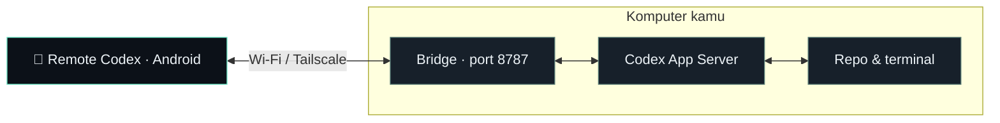

<p align="center">
  
</p>

<h1 align="center">Remote Codex</h1>

<p align="center">
  <strong>Codex di komputer. Kendali dari HP.</strong><br />
  Buat chat, kirim arahan, dan tinjau persetujuan dari Android.<br />
  File dan proses agent tetap berjalan di komputermu.
</p>

<p align="center">
  <a href="https://github.com/kohryan/remote-codex/releases/latest"></a>
  <a href="https://github.com/kohryan/remote-codex/actions/workflows/check.yml"></a>
  
  
</p>

<p align="center">
  <a href="https://github.com/kohryan/remote-codex/releases/latest/download/remote-codex.apk"><strong>⬇ Unduh APK</strong></a>
  &nbsp;·&nbsp; <a href="#mulai">Mulai cepat</a>
  &nbsp;·&nbsp; <a href="#jarak-jauh">Akses jarak jauh</a>
  &nbsp;·&nbsp; <a href="https://github.com/kohryan/remote-codex/issues">Laporkan masalah</a>
</p>

---

Remote Codex adalah klien Android komunitas untuk Codex lokal. Aplikasi native Java terhubung ke bridge Node.js di komputer, lalu bridge berkomunikasi dengan Codex App Server menggunakan login Codex yang sudah ada. Tidak perlu API key baru atau dependency npm untuk menjalankan bridge; akses model tetap mengikuti akun Codex kamu.

> **Tentang chat desktop:** pada mode `standalone`, pesan pertama ke chat desktop membuat **salinan dengan konteks percakapan**. Sinkronisasi langsung dengan chat desktop aktif belum tersedia pada mode ini. [Lihat cara kerja mode koneksi](#mode-koneksi).

## ✨ Dari HP, kamu bisa…

| | Fitur | Yang tersedia |
| :---: | --- | --- |
| 💬 | **Mulai percakapan** | Buat chat baru dan pilih folder repo di komputer. |
| 🗂️ | **Buka riwayat** | Cari chat lokal dan muat percakapan sebelumnya. |
| ⚡ | **Arahkan pekerjaan** | Kirim pesan dan baca balasan bertahap. |
| ✋ | **Tinjau persetujuan** | Baca detail perintah atau perubahan file, lalu setujui sekali atau tolak. |
| 📝 | **Jawab pertanyaan** | Balas permintaan input dari agent. |
| ⏹️ | **Hentikan proses** | Interupsi turn aktif pada chat yang dikendalikan bridge. |

## 🧭 Cara kerjanya



HP mengirim arahan dan menampilkan hasil. Agent membaca file, mengedit kode, dan menjalankan tool di komputer. Saat memakai Tailscale, HP dan komputer dapat berada di lokasi berbeda.

<a id="mulai"></a>

## 🚀 Mulai dalam 3 langkah

**Siapkan:** komputer dengan Node.js 22+, Git, dan Codex CLI yang sudah login; HP Android 8.0+; serta koneksi Wi-Fi yang sama atau Tailscale. Build bridge dan integrasi lokal diverifikasi di macOS; sistem operasi host lain belum diuji.

### 1. Jalankan bridge di komputer

Jika belum login ke Codex, jalankan `codex login` terlebih dahulu.

```sh
git clone https://github.com/kohryan/remote-codex.git
cd remote-codex
./start.sh
```

Terminal menampilkan alamat komputer dan lokasi token pairing. `start.sh` menerima koneksi jaringan pada port `8787`. Biarkan proses bridge berjalan.

Secara default, folder kerja yang dapat dipilih adalah subfolder di direktori induk `remote-codex`. Untuk memakai direktori repo sendiri:

```sh
REMOTE_CODEX_ROOT="$HOME/Projects" ./start.sh
```

Direktori tersebut harus sudah ada. Jika bridge sebelumnya masih berjalan, hentikan dulu dengan `Ctrl+C`, lalu jalankan kembali dengan pengaturan baru.

### 2. Pasang APK di HP

Unduh **[remote-codex.apk dari rilis terbaru](https://github.com/kohryan/remote-codex/releases/latest/download/remote-codex.apk)**, buka file-nya di Android, lalu izinkan instalasi dari sumber yang kamu gunakan.

<details>
<summary>Opsional: verifikasi checksum unduhan</summary>

Unduh juga `remote-codex.apk.sha256` dari [halaman rilis](https://github.com/kohryan/remote-codex/releases/latest). Letakkan kedua file dalam folder yang sama, lalu jalankan di komputer:

```sh
# macOS
shasum -a 256 -c remote-codex.apk.sha256

# Linux
sha256sum -c remote-codex.apk.sha256
```

</details>

### 3. Hubungkan dan mulai chat

Di aplikasi **Remote Codex → Koneksi**, isi:

| Isian | Nilai |
| --- | --- |
| **Alamat komputer** | `http://IP_KOMPUTER:8787` — ganti `IP_KOMPUTER` dengan IP LAN atau IP Tailscale komputer. |
| **Token pairing** | Isi file `.private/token` di folder repo pada komputer. |

Buka file token di komputer atau tampilkan dari direktori repo:

```sh
cat .private/token
```

Tempel token ke aplikasi, tekan **Hubungkan → Chat baru**, lalu pilih repo. Misalnya, kirim: *“Cek repo ini dan jelaskan strukturnya.”*

**Simpan token untuk dirimu sendiri.** Jangan masukkan nilainya ke issue, screenshot, atau pesan publik.

<a id="jarak-jauh"></a>

## 🌍 Beda lokasi? Pakai Tailscale

1. Instal [Tailscale di komputer](https://tailscale.com/download) dan [di Android](https://tailscale.com/download/android).
2. Login dengan **akun yang sama** dan aktifkan Tailscale di kedua perangkat. Selesaikan izin VPN atau system extension yang diminta sistem.
3. Salin **IP Tailscale komputer**, biasanya berbentuk `100.x.x.x`, dari daftar perangkat Tailscale.
4. Di **Remote Codex → Koneksi**, gunakan `http://IP_TAILSCALE_KOMPUTER:8787` dengan IP tersebut. Token pairing tetap sama.
5. Coba matikan Wi-Fi HP dan gunakan data seluler, lalu kirim chat untuk menguji koneksi jarak jauh.

Komputer harus tetap menyala, terhubung internet, dan menjalankan bridge. Saat HP ditutup, agent di komputer tetap dapat bekerja; balasan akan dimuat ketika aplikasi dibuka kembali.

Jika Mac tidak bisa diakses, periksa **Tailscale → Settings → Allow incoming connections**. [Panduan koneksi resmi Tailscale](https://tailscale.com/docs/how-to/connect-to-devices).

<a id="mode-koneksi"></a>

## 🔌 Mode koneksi Codex

Bridge memilih mode berdasarkan ketersediaan control socket lokal:

| Mode | Perilaku | Status verifikasi |
| --- | --- | --- |
| **`standalone`** | Menjalankan `codex app-server` dengan akun dan riwayat lokal yang sama. Chat baru milik bridge bisa dilanjutkan. Chat desktop disalin saat pesan pertama dikirim, beserta konteksnya. | Chat baru dan fork telah diuji dengan Codex lokal. |
| **`shared`** | Menggunakan `codex app-server proxy` untuk terhubung ke proses yang menyediakan control socket. | Diuji menggunakan mock protokol; belum diuji pada desktop dengan control socket aktif. |

Instalasi desktop yang dipakai saat pengembangan belum menyediakan control socket bersama. Hindari membuka dan menjalankan chat milik bridge pada proses Codex lain secara bersamaan.

App Server masih eksperimental dan protokolnya dapat berubah. Versi yang diverifikasi: **`codex-cli 0.166.0-alpha.5.1`**. [Dokumentasi Codex App Server](https://learn.chatgpt.com/docs/app-server).

## 🔐 Akses dan penyimpanan token

- Setiap permintaan ke bridge memerlukan token. Token dibuat otomatis di `.private/token` dengan izin file `0600` dan tidak ditanam di APK atau ditulis ke log bridge.
- Android menyimpan token terenkripsi **AES-GCM melalui Android Keystore**. Data pairing dikecualikan dari backup dan transfer perangkat.
- Chat baru dan fork memakai sandbox **`workspace-write`**, reviewer pengguna, serta kebijakan **`on-request`**. Persetujuan dari HP berlaku sekali per tindakan.
- `REMOTE_CODEX_ROOT` membatasi folder kerja dan riwayat yang dapat diakses melalui API. Batas ini bukan sandbox OS tambahan; eksekusi agent mengikuti sandbox Codex dan izin pengguna.
- Aplikasi menolak redirect dan alamat HTTP publik. **HTTP LAN tidak memakai TLS:** gunakan jaringan tepercaya atau VPN terenkripsi. Jangan meneruskan port HTTP `8787` langsung ke internet. Jika memakai host publik, gunakan reverse proxy HTTPS menuju bridge loopback.

Untuk mencabut pairing: hentikan bridge, hapus `.private/token`, jalankan kembali, lalu pair ulang. Simpan `.private/state.json` agar bridge mengenali chat remote dan pasangan fork setelah restart.

## ⚙️ Konfigurasi

| Variabel | Default / fungsi |
| --- | --- |
| `REMOTE_CODEX_ROOT` | Direktori induk repo `remote-codex`; menentukan folder kerja dan riwayat yang bisa diakses melalui bridge. |
| `REMOTE_CODEX_HOST` | `0.0.0.0` saat memakai `start.sh`; `127.0.0.1` saat memakai `npm start`. |
| `PORT` | `8787` |
| `CODEX_BIN` | `codex` pada `PATH` |
| `CODEX_HOME` | Dipakai oleh Codex CLI; bila disetel, juga menjadi direktori dasar control socket. |
| `REMOTE_CODEX_SOCKET` | `$CODEX_HOME/app-server-control/app-server-control.sock`, atau path setara dalam `~/.codex` jika `CODEX_HOME` tidak disetel. |

Untuk koneksi loopback saja, gunakan `npm start`. Bridge tidak mengubah konfigurasi global Codex.

## 🛠️ Build dan pengembangan

Bridge menggunakan modul bawaan Node.js. UI Android memakai Java dan komponen platform, tanpa WebView atau dependency UI tambahan.

**Toolchain Android:** JDK 17 · Android SDK Platform 35 · Build Tools 35.0.0 · Gradle 8.11.1 · Android Gradle Plugin 8.9.2.

```sh
# Setelah Android command-line tools terpasang
sdkmanager 'platforms;android-35' 'build-tools;35.0.0' 'platform-tools'
npm run build:android
```

Hasil build tersedia di **`dist/remote-codex.apk`**. Atur `ANDROID_HOME` jika SDK berada di lokasi lain; pada macOS, skrip memakai `$HOME/Library/Android/sdk` secara default.

APK v0.1.0 dan hasil build di atas adalah **debug APK bertanda tangan untuk penggunaan pribadi**, belum rilis Play Store. Gunakan signing key rilis sendiri untuk distribusi produksi dan jangan commit key. APK dari mesin atau CI berbeda bisa memakai debug key berbeda, sehingga tidak selalu bisa dipasang sebagai pembaruan tanpa uninstall.

<details>
<summary>Struktur repo</summary>

```text
remote-codex/
├── android/           # Aplikasi Android native
├── server/            # HTTP bridge dan klien RPC Codex
├── scripts/           # Skrip build APK
├── test/              # Pengujian bridge
├── docs/assets/       # Logo dan aset identitas proyek
├── .github/workflows/ # Pengujian dan build otomatis
└── start.sh           # Jalankan bridge untuk LAN / Tailscale
```

</details>

### Menjalankan pemeriksaan

```sh
npm test
cd android
./gradlew assembleDebug lintDebug
```

Delapan test bridge mencakup autentikasi, penolakan `Origin`, batas path dan symlink, fork desktop, deduplikasi pesan, mode shared, stream, serta persetujuan. Uji integrasi lokal juga menerima `REMOTE_CODEX_OK` dari chat baru dan `FORK_OK` dari lanjutan hasil fork.

## 💡 Bantuan cepat

| Kendala | Yang perlu diperiksa |
| --- | --- |
| **Tidak bisa terhubung** | Bridge masih berjalan, alamat komputer benar, dan port `8787` dapat dijangkau. Untuk beda lokasi, aktifkan Tailscale di kedua perangkat. |
| **Token salah** | Salin ulang isi `.private/token`. Jika token diganti, perbarui juga pada aplikasi Android. |
| **Repo tidak muncul** | Pastikan folder berada di bawah `REMOTE_CODEX_ROOT` dan direktori itu sudah ada. |
| **Muncul chat salinan** | Ini perilaku mode `standalone` saat melanjutkan chat dari desktop. |
| **Pesan belum terkonfirmasi** | Periksa riwayat sebelum mengirim ulang. Bridge tidak mengirim ulang otomatis; deduplikasi berlaku selama proses bridge yang sama. |
| **Koneksi Codex terputus** | Mulai ulang bridge. Bridge tidak menghentikan proses desktop. |

### Batas versi awal

- Pembaruan chat memakai polling setiap 1,2 detik saat layar chat terbuka; belum ada push notification atau foreground service Android.
- Mendukung teks dan aktivitas dasar. Lampiran, rich Markdown, serta review diff interaktif belum tersedia. Approval menampilkan detail JSON termasuk perintah/diff bila tersedia.
- Permintaan izin sandbox khusus ditolak dan elicitation MCP dibatalkan. Gunakan desktop untuk alur tersebut.
- Mode `shared` belum diverifikasi pada proses desktop nyata. Pengujian otomatis belum mencakup UI di perangkat fisik.

## 🤝 Ikut memperbaiki

Temukan bug atau punya ide? Buka [issue](https://github.com/kohryan/remote-codex/issues) dengan versi APK/Codex, versi Android, dan langkah reproduksi. Sertakan pesan error yang relevan setelah menghapus token dan informasi privat.

Untuk perubahan kode, jelaskan perilaku sebelum/sesudah dan hasil pemeriksaan pada pull request. Untuk masalah yang berpotensi membuka akses tanpa izin, gunakan kontak yang dicantumkan maintainer di [profil GitHub](https://github.com/kohryan); jangan publikasikan token atau detail eksploitasi aktif dalam issue.

---

<p align="center">
  Dibuat oleh <a href="https://github.com/kohryan">@kohryan</a> · Klien komunitas, tidak berafiliasi dengan OpenAI.<br />
  <sub>Logo README memakai simbol terminal yang sama dengan ikon APK. <a href="docs/assets/">Aset logo & preview tautan</a>.</sub>
</p>
